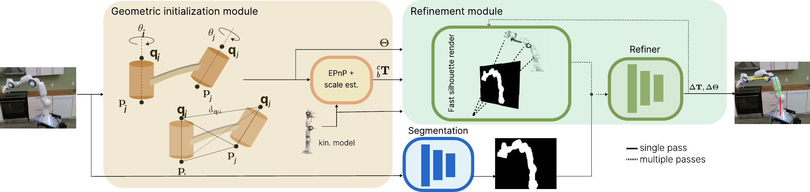

# GISR: Geometric Initialization and Silhouette-Based Refinement for Single-View Robot Pose and Configuration Estimation

<p align="center">
  
</p>

This repository contains the code accompanying the paper **GISR: Geometric Initialization and Silhouette-Based Refinement for Single-View Robot Pose and Configuration Estimation.**

## Dataset
Nvidia's [DREAM dataset](https://github.com/NVlabs/DREAM/blob/master/data/DOWNLOAD.sh) contains synth and real data for Franka's Panda robot used in the paper. For UR5 robot you can use `generate_synth_data.py` script from this repo.

## Train and eval
Train and eval options can be found in `config.py`. The code supports multi-gpu training via accelerate. To train or evaluate, use the following commands:

```
python run_train.py --robot panda
```
```
python run_test.py --robot panda
```
You can also use the code in `train_segmentation.py` to train a deeplabv3 robot segmentation model. The code can easily be adapted to generate ground-truth robot segmentation maps from ground-truth robot joint angles and camera-to-robot pose in the dataset, and robot meshes (in `urdfs`).

## Model checkpoints
Some checkpoints can be downloaded from [here](https://drive.google.com/drive/folders/1aY2Nl41XSNsGDitaHYUU_JpmaHceb3wC?usp=sharing). `panda_refiner.pth` is the iterative deep refinement model trained on 100k synthetic samples from the DREAM dataset. `panda_edm_model.pth` that estimates initial configurations as part of the GIM was trained as described in this [paper](https://arxiv.org/abs/2301.02051) (all the core logic required for training is already implemented in `edm_net.py, edm_ops.py, edm_utils.py`, publishing a training script is still WIP). `panda_segmentation.pth` was trained using `train_segmentation.py`.

## Camera-to-robot extrinsic calibration
Our code can be used to perform camera-robot extrinsic calibration for a given camera-robot setup, or to refine calibration results obtained from a marker-based method. In any of these cases, use the ground-truth robot configuration (instead of predicting it) and set the 2D robot keypoints expected by the model to the outputs of a real robot keypoint detector (e.g. [this](https://github.com/NVlabs/DREAM) or [this](https://github.com/ucsdarclab/CtRNet-robot-pose-estimation)). For offline calibration (a typical scenario), consider increasing the number of deep refinement iterations, it can yield more accurate results. For online calibration, using a lower number of iterations (e.g., 3) is recommended to maintain real-time performance.

## Citation

If you use any of this code or find it useful in your research work, please kindly cite the relevant publications listed here.

```bibtex
@article{bilic2024gisr,
  author={Bilić, Ivan and Marić, Filip and Bonsignorio, Fabio and Petrović, Ivan},
  journal={IEEE Robotics and Automation Letters}, 
  title={GISR: Geometric Initialization and Silhouette-Based Refinement for Single-View Robot Pose and Configuration Estimation}, 
  year={2024},
  volume={9},
  number={11},
  pages={9883-9890}
}

@article{bilic2023edmq,
  title = {A Distance-Geometric Method for Recovering Robot Joint Angles From an RGB Image},
  journal = {IFAC-PapersOnLine},
  volume = {56},
  number = {2},
  pages = {1003-1008},
  year = {2023},
  note = {22nd IFAC World Congress},
  issn = {2405-8963},
  author = {Ivan Bilić and Filip Marić and Ivan Marković and Ivan Petrović}
}

@article{maric2022riemannian,
  author  = {Filip Maric and Matthew Giamou and Adam W. Hall and 
             Soroush Khoubyarian and Ivan Petrović and Jonathan Kelly},
  title   = {Riemannian Optimization for Distance-Geometric Inverse Kinematics},
  journal = {IEEE Transactions on Robotics},
  volume  = {38},
  number  = {3},
  pages   = {1703--1722},
  month   = {June},
  year    = {2022}
}
